<h1>Hi, I'm Madhav Bondhare 👋</h1>

<h3>Full Stack Developer | Exploring AI &amp; Backend Engineering</h3>

I build practical web applications, explore backend systems, and experiment with AI-powered solutions.

  
  
  

 

## 👨‍💻 About Me

- 💻 Full Stack Developer focused on building useful, reliable web applications
- ⚙️ Comfortable across frontend interfaces, backend APIs, and relational databases
- 🤖 Exploring AI integration, local LLMs, and practical GenAI applications
- 🧠 Interested in software architecture, system design, and maintainable code
- 🌱 Continuously learning by building and improving real projects

 

## 🧰 Tech Stack

<table>
  <tr>
    <td width="25%"><b>Languages</b></td>
    <td></td>
  </tr>
  <tr>
    <td><b>Frontend</b></td>
    <td></td>
  </tr>
  <tr>
    <td><b>Backend &amp; Database</b></td>
    <td></td>
  </tr>
  <tr>
    <td><b>Tools &amp; Platforms</b></td>
    <td></td>
  </tr>
</table>

 

## 📊 GitHub Analytics

 

 

## 🤝 Let's Connect

Interested in development, backend engineering, AI, or building something useful? 
Let's connect.

  
  &nbsp;&nbsp;&nbsp;
  
  &nbsp;&nbsp;&nbsp;
  

  

Building, learning, and improving — one commit at a time.

